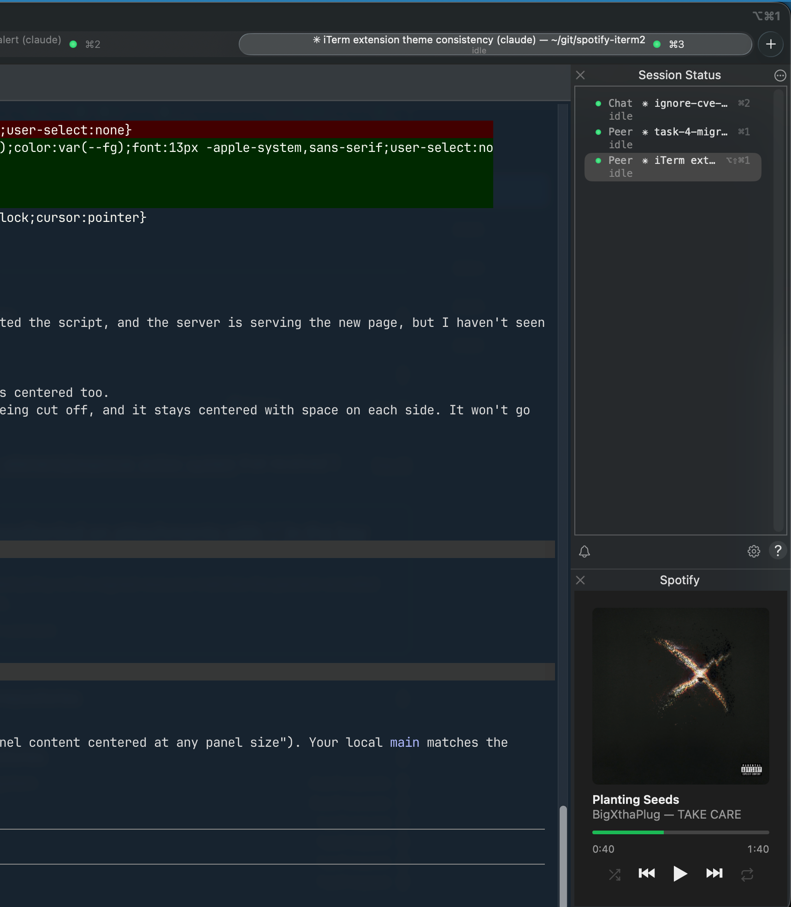

# spotify-iterm2

A small Spotify now-playing panel for the iTerm2 Toolbelt.



- Album art (click it to open Spotify)
- Track, artist and album
- Progress bar (click it to seek)
- Shuffle, previous, play/pause, next and repeat buttons

It's a single Python file that talks to the Spotify desktop app through AppleScript. You don't need a Spotify account login, an API key or any extra packages.

## Requirements
- macOS
- [iTerm2](https://iterm2.com) 3.5 or newer
- The Spotify **desktop app** (the web player isn't supported)

## Install
1. In iTerm2, open **Settings → General → Magic** and tick **Enable Python API**.
2. Copy the script into iTerm2's AutoLaunch folder:
   ```sh
   mkdir -p ~/Library/Application\ Support/iTerm2/Scripts/AutoLaunch
   cp spotify_toolbelt.py ~/Library/Application\ Support/iTerm2/Scripts/AutoLaunch/
   ```
3. Restart iTerm2. The first time an iTerm2 Python script runs, iTerm2 may offer to download its Python runtime. Accept.
4. Open **Toolbelt → Show Toolbelt**, then tick **Toolbelt → Spotify**.
5. When macOS asks whether iTerm2 may control Spotify, click **Allow**.

## Update
Copy the new `spotify_toolbelt.py` over the old one using the same `cp` command, then restart iTerm2.

## Uninstall
```sh
rm ~/Library/Application\ Support/iTerm2/Scripts/AutoLaunch/spotify_toolbelt.py
```
Then restart iTerm2.

## Notes
- The panel runs a local web server on `127.0.0.1:8765`. It only listens on your own machine. If that port is already taken, change `PORT` at the top of the script.
- Spotify doesn't let you change shuffle and repeat for some sources, such as radio and autoplay. The buttons are greyed out when that happens.
- **The panel says "Spotify is not running" but Spotify is open:** the Automation permission was probably denied. Turn it on under **System Settings → Privacy & Security → Automation → iTerm2 → Spotify**.
